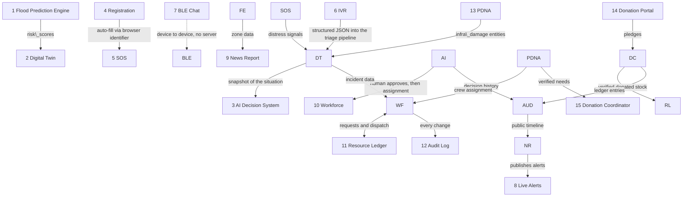

# Sahayak — Tab Write-ups in Script Order

### Team Try-Catchers | SIH 2026 | Problem Statement SIH26206 | Theme: Disaster Management

\---

## How to read this file

* The chapters follow the order of the speaking script: **Flood Engine → Digital Twin → AI Decision System → Registration → SOS → IVR → BLE Chat → Workforce + Resource Ledger → Donation**.
* Tabs that were not part of the script's main chain are **inserted at the point where they connect** and are marked *(inserted)*. Nothing from your write-ups was removed.
* Every chapter uses the same three headings: **1. Functions – What it does / why it is used**, **2. Inspiration – Why we came up with this idea**, **3. Engineering Interpretation – How it works from an engineering perspective**.
* Each chapter starts with a **Connects from / Leads to** line, so you can see how one tab hands over to the next. These links are taken from your own write-ups.
* **Source tags:**

  * *Written by team* means the wording is exactly what you shared.
  * *Added from Notion specs* means the tab was missing from your write-ups and was drafted from the Notion feature pages.
* Four of your entries (Digital Twin, AI Decision System, IVR, BLE Chat) used the labels "The Function / The Inspiration / What we built (and what's simulated)". They are mapped to the three standard headings, and the wording under them is unchanged.
* Items that need a team decision are collected in **Open Items** at the end, marked `\[CONFLICT]`, `\[VERIFY]` or `\[DETAIL REQUIRED]`.

## Chapter map

|#|Chapter|Phase|Position|
|-|-|-|-|
|1|Flood Prediction Engine|Before|Script chapter|
|2|Digital Twin (2D Geospatial Dashboard)|During|Script chapter|
|3|AI Decision System|During|Script chapter|
|4|Registration Portal|Before|Script chapter|
|5|SOS / Report Help Button|During|Script chapter|
|6|IVR (Browser Simulation)|During|Script chapter|
|7|BLE Chat (Mocked Mesh Network)|During|Script chapter|
|8|Live Alerts \& Updates|Before + During|*(inserted)*|
|9|News Report / Public Communications AI|During + After|*(inserted)*|
|10|Workforce Tab|During|Script chapter|
|11|Resource Ledger / Resource Manager|During|Script chapter (merged with Workforce in your list)|
|12|Audit Log|During + After|*(inserted)*|
|13|PDNA — Damage Reporting|After|*(inserted)*|
|14|Donation Portal (citizen-facing)|After|Script chapter|
|15|Donation Coordinator / Relief Ledger|After|Script chapter|

## How the chapters connect

\---

## 1\. Flood Prediction Engine

**Phase:** Before | *Written by team*

**Connects from:** public rainfall, river discharge and elevation data.
**Leads to:** the Command Dashboard heatmap (the Digital Twin, chapter 2) and the AI Resource Allocation Optimizer (the AI Decision System, chapter 3).

**1. Functions – What it does / why it is used**
The Flood Prediction Engine continuously calculates a flood risk score (0–100) for every village/ward in a district, using public rainfall, river discharge, and elevation data. It is used because existing flood warnings are typically district- or river-basin-level — too broad for a DDMA control room to act on precisely. This engine gives hyperlocal, ward-level risk visibility so resources (boats, teams, shelters) can be positioned before a flood peaks, not after, and it feeds both the Command Dashboard's heatmap and the AI Resource Allocation Optimizer's dispatch recommendations.

**2. Inspiration – Why we came up with this idea**
During research, we found that flood alerts in India are usually issued at too coarse a level (district/river basin), leaving DDMA officials to guess which specific villages or wards need priority attention. We also found that Google's Flood Hub already solves river-level forecasting well — so instead of duplicating that effort, we were inspired to build the missing layer: translating broad river/rainfall data into hyperlocal, actionable risk for urban drainage and flash-flood-prone wards, which existing public tools don't fully provide at that granularity.

**3. Engineering Interpretation – How it works from an engineering perspective**
For each ward, live rainfall (Open-Meteo), river discharge (CWC portal/Google's open datasets), and static elevation/drainage data (satellite DEM) are merged into one feature vector. This is passed into a pre-trained XGBoost classifier, which outputs a flood probability (0–1) converted to a 0–100 risk score, rather than a blunt yes/no. The model was trained offline on historical flood events (Inundation History dataset), learning which feature combinations preceded real floods. Scores recompute every 3–6 hours (matching real data update frequency) and are written as timestamped rows to a risk\_scores table in PostgreSQL + PostGIS, which the Dashboard and Optimizer read directly — keeping one single source of truth across the platform. The model is validated via backtesting against 8–10 real historical floods, comparing predicted risk maps to actual flood extent.

\---

## 2\. Digital Twin (2D Geospatial Dashboard)

**Phase:** During | *Written by team*

**Connects from:** the Flood Engine's risk scores, SOS reports, and PDNA damage reports.
**Leads to:** the AI Decision System, which works from a snapshot of this picture, and the Workforce tab, which matches assignments to the incidents shown here.

**1. Functions – What it does / why it is used**
A 2D geospatial dashboard that maps distress signals, resource deployments, and hazard zones for command center operators.

**2. Inspiration – Why we came up with this idea**
The inspiration came from the "naming trap"—in text logs, "Sector 11" and "Sector 12" sound adjacent, but a river might separate them in reality. I wanted to eliminate the cognitive load of administrators having to mentally visualize text data during a crisis.

**3. Engineering Interpretation – How it works from an engineering perspective** *(what we built, and what's simulated)*
We engineered a 2D WebGIS implementation using MapLibre. On the backend, we heavily utilized PostGIS, storing locations natively with spatial GiST indexes for rapid querying. To keep the UI instantly in sync, we built a twin aggregator service that listens to the database and streams state changes to the frontend via a custom FastAPI WebSocket proxy.

\---

## 3\. AI Decision System

**Phase:** During | *Written by team*

**Connects from:** the Digital Twin's live picture and the Flood Engine's priority score.
**Leads to:** a human operator, who applies the suggested allocation; approved assignments reach the Workforce tab (chapter 10).

**1. Functions – What it does / why it is used**
A reasoning engine that evaluates incoming distress signals against official protocols and suggests resource allocations for a human operator to apply.

**2. Inspiration – Why we came up with this idea**
I was researching Constitutional AI and how models are trained against written principles. However, even rule-trained models can hallucinate. I realized we couldn't trust the model implicitly; we needed to validate its output strictly in code before passing it to a human.

**3. Engineering Interpretation – How it works from an engineering perspective** *(what we built, and what's simulated)*
We implemented an LLM pipeline with deterministic guardrails. It evaluates situations against procedures modeled directly on NDMA flood-response guidance. To avoid acting on outdated data, we take a database snapshot at request time and run a strict staleness check. Most importantly, the AI's JSON output is validated purely in code against our actual SQL inventory before it ever reaches the "Human in the Loop" approval stage.

\---

## 4\. Registration Portal (Citizen Portal)

**Phase:** Before | *Written by team*

**Connects from:** the citizen, in peacetime, before any disaster.
**Leads to:** SOS (chapter 5): the persisted browser identifier lets SOS auto-fill the citizen's details.

**1. Functions – What it does / why it is used**
Lets a citizen optionally create a profile ahead of time — identity (Phone OTP + mock Government ID), basic details and home/work location (tap-to-pin), and medical/family information (blood group, conditions, family roster with vulnerability flags). On completion, the device silently caches offline survival guides and a shelter map.

**2. Inspiration – Why we came up with this idea**
Responders usually have no advance knowledge of who lives where, what medical needs they have, or who their family is — that information only becomes available (if at all) during the chaos of the emergency itself, when there's no time to collect it properly.

**3. Engineering Interpretation – How it works from an engineering perspective**
A multi-step wizard writing to a `citizens` table (plus a linked `family\_members` table), with a persisted browser identifier returned on success. That identifier is the link between Registration and SOS: any later SOS submission from the same device looks up this identifier to auto-fill name, medical, and family data instantly. Registration is deliberately non-blocking — it lives behind a side-menu entry point, never on the home screen, and SOS continues to work identically whether or not a citizen has ever registered.

\---

## 5\. SOS / Report Help Button (Citizen Portal)

**Phase:** During | *Written by team*

**Connects from:** Registration (auto-fill), or a short manual entry if the citizen never registered.
**Leads to:** the Digital Twin, where the distress signal appears on the map.

**1. Functions – What it does / why it is used**
Lets any citizen send an emergency distress signal in seconds, with almost no typing — headcount, three quick flags (medical emergency / infants / elderly), auto-captured GPS location, and an optional landmark note. Works whether or not the citizen has registered, and works over SMS if there's no internet.

**2. Inspiration – Why we came up with this idea**
During a real disaster, every second spent filling out a form is a second not spent getting help. People in panic can't type an address or fill long forms, and cellular networks often fail exactly when they're needed most — so the system has to work under the worst possible conditions, not the best.

**3. Engineering Interpretation – How it works from an engineering perspective**
A single-screen form backed by the device's native Geolocation API, with a dual-transmission design: an online POST request as the primary path, falling back to a compressed SMS string opened via a native deep link when offline. The backend deduplicates repeated submissions from the same phone/session/location within a time window (debounce, not a new ticket each tap), and returns a compass bearing plus distance to the nearest shelter rather than a routed path, since flood conditions can make a "safe route" unsafe without warning.

\---

## 6\. IVR (Browser Simulation)

**Phase:** During | *Written by team*

**Connects from:** a citizen who cannot use the app (no visual interface needed).
**Leads to:** the same triage pipeline as SOS, as structured JSON payloads.

**1. Functions – What it does / why it is used**
A voice and keypad-prompted emergency reporting system that allows citizens to log SOS requests without needing a visual interface.

**2. Inspiration – Why we came up with this idea**
The idea sparked while I was using an automated phone line to deactivate a bank account. I realized IVR automates tasks, requires zero technical literacy, works without a smartphone, and functions on basic 2G networks. Disaster victims face the exact same constraints.

**3. Engineering Interpretation – How it works from an engineering perspective** *(what we built, and what's simulated)*
Because we couldn't provision a physical telecom trunk, we simulated the IVR entirely in the browser. We synthesized text-to-speech on-the-fly using the Web Speech API, and generated DTMF keypad sounds locally using the Web Audio API oscillator. To handle the voice inputs, we embedded a mock speech-to-text (STT) function directly into our backend ingestion route, translating the call into structured JSON payloads for the triage pipeline.

\---

## 7\. BLE Chat (Mocked Mesh Network)

**Phase:** During | *Written by team*

**Connects from:** the SOS tab's low-bandwidth SMS design, taken one step further for the case where cell towers are completely down.
**Leads to:** a local edge node only. This layer is device to device and does not report to the server.

**1. Functions – What it does / why it is used**
A peer-to-peer communication layer allowing citizens and responders to exchange critical messages when cellular infrastructure fails.

**2. Inspiration – Why we came up with this idea**
While building our low-bandwidth SMS SOS feature, I asked what happens when cell towers are completely down. I knew Bluetooth works independently of towers. (Watching Dr. Stone also reinforced how basic communication networks create a massive strategic advantage).

**3. Engineering Interpretation – How it works from an engineering perspective** *(what we built, and what's simulated)*
Because we built a web app on a hackathon timeline, we used a Web Bluetooth GATT client. However, since browsers cannot act as background peripheral relays due to sandbox limits, we engineered a simulation engine that mocks peer discovery, radio latency, and hop counts. It proves the fundamental logic of device-to-device messaging, passing lightweight string messages to a local edge node.

\---

## 8\. Live Alerts \& Updates (Citizen Portal) *(inserted)*

**Phase:** Before + During | *Written by team*

**Connects from:** the Government Portal's admin side, which publishes to the `Public\_Alerts` table (see chapter 9).
**Leads to:** the citizen, as a read-only feed. There is no path for citizens to post into it.

**1. Functions – What it does / why it is used**
A read-only, scrollable feed of official government alerts — weather warnings, evacuation notices, safe-zone instructions — shown as severity-coded cards (Critical / Warning / Info), filtered to the citizen's detected state, with on-demand translation into 11 languages and text-to-speech playback for anyone who can't read.

**2. Inspiration – Why we came up with this idea**
During a crisis, citizens often fall back on unverified WhatsApp forwards and rumors because there's no single trusted source that's fast, current, and easy to understand — especially for people who don't read the dominant language or can't read at all.

**3. Engineering Interpretation – How it works from an engineering perspective**
A lightweight, cached feed (using SWR) reading from the same `Public\_Alerts` table the Government Portal's admin side publishes to — strictly read-only on the citizen side, so there's no path for citizens to inject unverified content. GPS coordinates resolve to a state server-side for filtering, with a guaranteed fallback to the unfiltered nationwide feed if location fails. Translation and speech both use a hybrid approach: native browser capabilities first (instant, offline-capable) with a backend AI-service fallback (Sarvam) when the device lacks a given language's voice or when translation is needed.

\---

## 9\. News Report / Public Communications AI (Admin Portal) *(inserted)*

**Phase:** During + After | *Added from Notion specs*

**Connects from:** Flood Engine and Twin data for the chosen zone, and the append-only audit trail (chapter 12).
**Leads to:** citizens, through SMS broadcasts and the public timeline on the Citizen Portal; and the press, through a press portal.

**1. Functions – What it does / why it is used**
An AI drafting assistant that turns live operational data into communication for three different audiences, in three sub-tabs.

* **Citizen Alerts:** the admin clicks a zone on the map, AI drafts an SMS, the admin edits it, and it is broadcast to that geofence.
* **Media \& Press:** the admin picks a templated prompt, AI drafts a press release, the admin approves it and publishes it to a press portal.
* **Transparency \& Action Timeline:** events are auto-formatted into a public feed shown on the Citizen Portal; the admin can hide sensitive entries but cannot edit or invent them.

Nothing is sent or published without explicit admin review.

**2. Inspiration – Why we came up with this idea**
During a disaster, the same evolving situation has to be explained to three very different groups: endangered citizens, the press, and the general public. Done by hand this is slow and inconsistent, and delayed or unclear information is exactly what creates rumours and panic. We wanted admins to communicate fast without losing accuracy, and without handing control of public messaging to an AI.

**3. Engineering Interpretation – How it works from an engineering perspective**
A single AI Drafting Service (FastAPI) reuses the same base AI model integration as the AI Decision System. Sub-tab 1 pulls Flood Engine and Twin data for the selected zone, drafts the SMS, and on the admin's Broadcast click sends it through the SMS gateway to that geofence (stored in `sms\_alerts`). Sub-tab 2 combines a template with audit-trail data to draft a press release, stored in `press\_releases` on Publish. Sub-tab 3 is data-triggered: each new `tickets` / Twin event is formatted into a `news\_timeline` row with `public\_visible = true` by default; the Citizen Portal reads only visible rows. All three sub-tabs read the **same append-only audit trail**, so what is said publicly cannot drift from what actually happened. Broadcast and Publish both require a confirmation step, since they are external and irreversible.

*Spec status:* all three sub-tabs scoped for the demo; multi-language SMS drafting and multiple press formats are planned, not built. `\[VERIFY: is the SMS broadcast simulated, the same way SOS SMS is?]`

\---

## 10\. Workforce Tab (During + Resource Ledger)

**Phase:** During | *Written by team*

**Connects from:** SOS and incident data from the Digital Twin, and allocations from the AI Decision System.
**Leads to:** the Resource Ledger (chapter 11) for equipment and supplies, and the Audit Log (chapter 12), which records every change.

**1. Functions – What it does / why it is used**
Registers and tracks responders and volunteers (NDRF, medical staff, volunteers) with their skills, availability and location. Commanders assign them to incidents. The Resource Ledger tracks vehicles, boats and supplies the same way.

**2. Inspiration – Why we came up with this idea**
In disasters, people and equipment are often available but nobody knows where they are or who has the right skills. Assignments are made over phone calls and WhatsApp, causing duplication and gaps.

**3. Engineering Interpretation – How it works from an engineering perspective**
A role-based dashboard over a database of personnel and resources, with status states (available, assigned, deployed). Assignments are matched to SOS and incident data from the Digital Twin and AI Decision System. Each change is written to the Audit Log, so every allocation is traceable.

\---

## 11\. Resource Ledger / Resource Manager (Admin Portal)

**Phase:** During | *Added from Notion specs* — your Workforce entry covered it in one sentence

**Connects from:** the Workforce tab (resource requests) and the Donation Coordinator (verified donated stock).
**Leads to:** dispatch back to Workforce; the same `resources` table is read by the Digital Twin and the AI Decision System.

**1. Functions – What it does / why it is used**
One live inventory of everything on hand, across five fixed categories: Personnel, Ration, Medical Equipment, Vehicles and Shelter Objects. Each item carries a status (available / assigned / in transit / depleted / maintenance). Government stock is entered directly; verified donated stock transfers in from the Donation Coordinator. Requests from the Workforce tab appear in an action queue; the officer clicks Handover and the resource moves from available to assigned. Shelter rows show capacity against occupancy.

**2. Inspiration – Why we came up with this idea**
In a disaster, people and equipment are often available but nobody knows where they are or whether they are free, so officers end up cross-checking several sources by phone and message while teams wait. We also wanted every module that touches resources (Digital Twin, AI Decision System, Donation Coordinator, Workforce) to speak the same language, so we fixed the object model up front instead of letting each module invent its own.

**3. Engineering Interpretation – How it works from an engineering perspective**
A single `resources` table holds every item in one shape: category, subtype, name, quantity, status, PostGIS location, `assigned\_to`, and `source` (government or donation). Adding a new category later, for example drones, is just a new subtype entry with no backend rework. A Resource Service (FastAPI) validates manual stock entries against the schema, ingests approved donation transfers, matches Workforce requests against available inventory, and on Handover re-checks availability, flips status, notifies Workforce and logs the event to the Audit Log. The Digital Twin and AI Decision System read the same table, so there is one source of truth. Updates reach the dashboard live through Supabase Realtime and WebSocket. AI Insight cards (depletion and overcrowding flags, suggestion-only) and a Public Needs Broadcast are good-to-have, not core.

\---

## 12\. Audit Log (Admin Portal) *(inserted)*

**Phase:** During + After | *Added from Notion specs*

**Connects from:** every action in Workforce, Resource Ledger, PDNA and Donation Coordinator, plus state-change events from the Twin Aggregator.
**Leads to:** admins (Inquiry and Revert), and the News Report's public timeline (chapter 9), which reads the same trail.

**1. Functions – What it does / why it is used**
A live, searchable trail of every order and action in the system. Each entry is a ticket carrying the order name, timestamp, status (given / in progress / proceeded / reverted), who issued it, and which officer executed it. Admins can filter by type, department and time. Two actions are built into every ticket: **Inquiry**, where the admin asks a specific question, the responsible department is notified and must reply, forming a two-way thread; and **Revert**, available only while an order is "given" or "in progress," which sends a real-time stop signal to the officer executing it.

**2. Inspiration – Why we came up with this idea**
In a disaster, dozens of orders move fast across departments. Without a central trail, nobody can say who did what, when, or whether it actually happened, and if something goes wrong there is no way to trace it or correct it mid-course. The AI Decision System's approval gate only covers the moment *before* execution; we needed an accountability and correction layer for *during and after* execution. The goal was for accountability to be a property of the architecture rather than a policy people have to remember.

**3. Engineering Interpretation – How it works from an engineering perspective**
An event-driven Ticket Service (FastAPI) listens to events from the Workforce tab and the Twin Aggregator through Supabase Realtime and creates or updates rows in a `tickets` table; inquiry threads live in `ticket\_inquiries`. Every write is **append-only**: reverts and inquiries are added to a ticket's history, never edited or deleted. On Revert, the service validates that status is `given` or `in\_progress`, requires and stores a reason, and pushes a stop signal over the FastAPI WebSocket layer to the executing officer. A background job (APScheduler / asyncio) flags unanswered inquiries as overdue. The frontend is a live table with status badges and a pending-inquiry counter, kept in sync through WebSocket and Zustand. Other modules (AI Decision System, Resource Ledger, Workforce) write to the same trail, so it is system-wide, not Workforce-only.

*Spec status:* MVP in Notion (live list, filtering, working Revert, working Inquiry). Planned, not built: analytics and CSV/PDF export. `\[VERIFY: confirm Revert and Inquiry are working in the current build]`

\---

## 13\. PDNA (Post-Disaster Needs Assessment) — Damage Reporting *(inserted)*

**Phase:** After | *Written by team*

**Connects from:** citizens, registered or anonymous, who report damage with a photo, category, severity and location.
**Leads to:** the Digital Twin (spatial damage view), the Workforce Portal (crew assignment), the Admin dashboard (oversight), and, through the needs it raises, the Donation Portal and Donation Coordinator (chapters 14 and 15).

**1. Functions – What it does / why it is used**
PDNA lets citizens report infrastructure damage after a disaster by submitting a photo, damage category, severity level, and location. Each report gets a citizen-facing tracking ID (e.g. PDNA-1234) so reporters can follow status without logging in. Reports feed three downstream systems: the Digital Twin (for spatial damage visualization), the Workforce Portal (for crew assignment), and the Admin dashboard (for oversight). It closes the loop between "what's damaged on the ground" and "who's being sent to fix it."

**2. Inspiration – Why we came up with this idea**
In the immediate aftermath of a disaster, official damage assessments are slow — government teams physically survey affected areas, which can take days while people wait for help. Meanwhile, the people closest to the damage (residents, shopkeepers, passersby) already know exactly what's broken and where. PDNA crowdsources that first wave of ground-truth data, so response teams get a live, geotagged damage map within hours instead of days, and can triage critical damage before doing manual surveys.

**3. Engineering Interpretation – How it works from an engineering perspective**

* **Submission flow:** Citizen (registered or anonymous) submits a report via the PDNA Service → photo uploaded to Supabase Storage, metadata (category, severity, geolocation) written to pdna\_reports.
* **Identity handling:** reporter\_citizen\_id is nullable — anonymous reports are still accepted, keeping the barrier to reporting low during a crisis.
* **Spatial layer:** location is stored as geography(Point) using the same PostGIS pattern as the rest of the system, so it plugs directly into existing map/query logic — no new spatial tooling needed.
* **Status lifecycle:** status moves pending → assigned → resolved. Every transition is appended to tickets as an audit trail (not just overwritten), so the Audit Log can reconstruct full history per report.
* **Twin integration:** The Twin Aggregator reads pdna\_reports and writes derived entries into twin\_state with entity\_type: infra\_damage — this required zero schema change since twin\_state is already generic/entity-agnostic.
* **Workforce integration:** When a report is triaged, assigned\_workforce\_id links it to a row in workforce\_assignments, which the Workforce Portal reads to dispatch a crew — again, no new columns needed there.
* **Design principle:** the whole feature was built to bolt onto existing tables (tickets, twin\_state, workforce\_assignments) rather than create new relationships, keeping the data model consistent across Before/During/After phases of the system.

\---

## 14\. Donation Portal (citizen-facing)

**Phase:** After | *Written by team*

**Connects from:** needs raised by the PDNA reports and the Resource Manager.
**Leads to:** the Donation Coordinator (chapter 15), through a shared ledger.

**1. Functions – What it does / why it is used**
Lets citizens and organisations donate money, food, clothing or supplies for a specific disaster or need, and see where it goes.

**2. Inspiration – Why we came up with this idea**
People want to help during a disaster, but unverified appeals cause mistrust and misdirected aid. A single official channel tied to real needs fixes this.

**3. Engineering Interpretation – How it works from an engineering perspective**
A donation intake form feeds a shared ledger. Donations are categorised as cash or in-kind, and pledges are linked to needs raised by the PDNA reports and Resource Manager. Each donation gets a unique ID and status, and payments go through a gateway (mocked in the prototype).

\---

## 15\. Donation Coordinator / Relief Ledger

**Phase:** After | *Written by team*

**Connects from:** the Donation Portal's pledges and PDNA-verified damage and needs.
**Leads to:** the Resource Ledger (verified donated stock), donors (certificates), and the Audit Log (tamper-evident records).

**1. Functions – What it does / why it is used**
The admin side of donations. It matches incoming donations to verified needs, tracks distribution, and issues certificates to donors.

**2. Inspiration – Why we came up with this idea**
Donors rarely learn what happened to their contribution, and authorities struggle to prove transparency. A public ledger plus a certificate rewards donors and builds trust.

**3. Engineering Interpretation – How it works from an engineering perspective**
An append-only ledger records every transaction (received, allocated, distributed). Allocation rules map donations to PDNA-verified damage and needs. Certificates are generated automatically once a donation is confirmed, with a unique ID that can be verified. Audit Log entries make the records tamper-evident.

